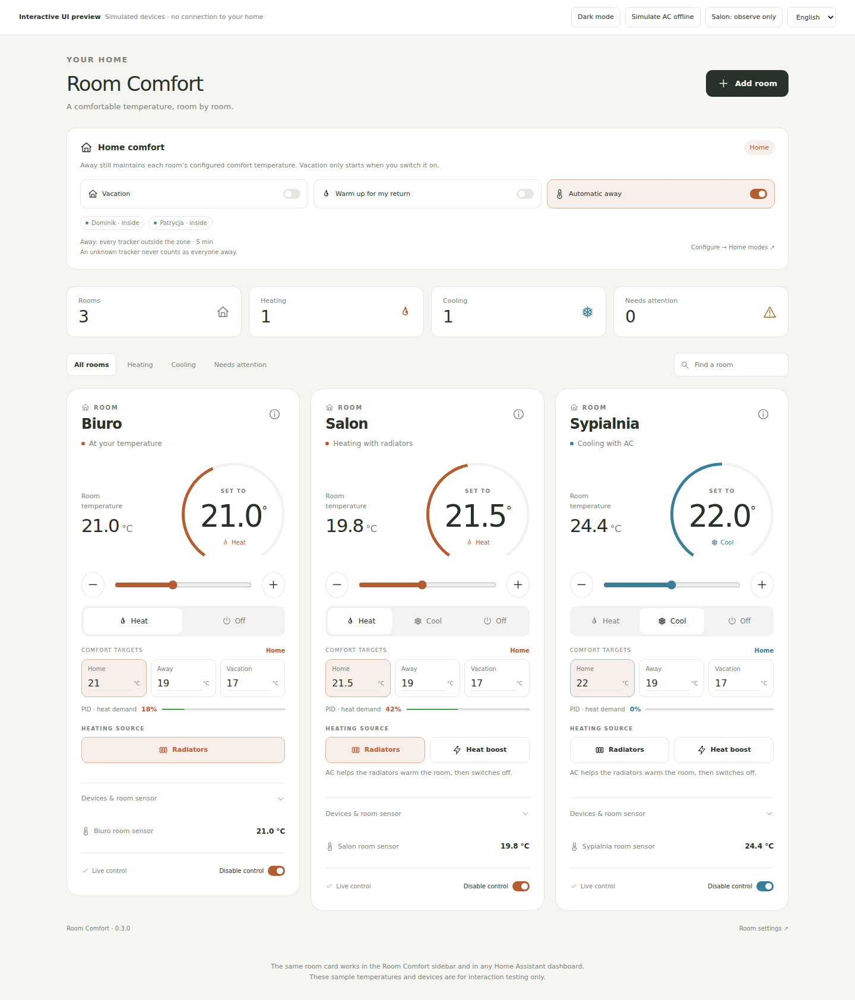

# Room Comfort

**Smooth room heating, pet-friendly Away targets, and a warm home when you return.**

A Home Assistant custom integration that coordinates radiator thermostats and an
optional reversible air conditioner using an independent room temperature sensor.
Includes a responsive room card, an all-rooms overview, and a sidebar page.



## Daily controls

| Control | Behaviour |
|---|---|
| Target temperature | Adjust with buttons or the slider |
| Heat → Radiators | PID makes bounded adjustments to native TRV targets using the room sensor |
| Home / Away / Vacation targets | Editable per room, also exposed as HA number entities |
| Automatic away | Applies Away only after every selected tracker is confirmed outside the home zone |
| Vacation switch | Manual override, retained until explicitly ended or Coming home is started |
| Coming home switch | Uses Home targets, holds them ready until arrival, cancellation or timeout |
| Heat boost | AC assists until the target is reached or the timer expires, then radiators maintain the temperature |
| Cool | AC cools; all radiators must report Off before cooling starts |
| Off | Requests all assigned devices Off |
| Control devices | Enables live commands; starts **off** on a fresh installation |

Each room card shows current/target temperature, heating source, boost countdown,
controller status, device details and room-sensor history through HA's more-info
dialog. Faults and command failures are visible. Observe-only mode shows planned
demand without operating devices.

The overview discovers all Room Comfort rooms and offers search plus All /
Heating / Cooling / Needs attention filters. Cards follow the HA theme and
support English and Polish. All frontend files are bundled with the integration.

[Mobile preview](docs/images/mobile.png) · [Dark theme](docs/images/dark.png)

## Installation

Requires Home Assistant **2026.10 or newer**. No Node build, separate card download,
external runtime service, or cloud account is needed on the HA host.

### Private repository

HACS **does not support private GitHub repositories**, including custom repos.
While this repo is private:

1. Download the source or install ZIP.
2. Copy `custom_components/room_comfort` into the HA configuration directory.
   On HA OS, the result should be
   `/config/custom_components/room_comfort/manifest.json`.
   Keep a copy of any existing version before replacing it.
3. Restart Home Assistant.
4. Open **Settings → Devices & services → Add integration → Room Comfort**.
5. Select a room name, temperature sensor, radiator thermostats, optional AC,
   and optional window contacts. Repeat for each room.
6. Open **Room Comfort** in the sidebar. The room cards appear automatically.
7. Leave Control devices off while reviewing readings and planned demand.
   When ready for a live trial, select Heat and enable Control devices.

An authenticated Git checkout can also supply the files. This integration does
not create credentials or store GitHub tokens.

### HACS, if the repository becomes public later

The source has the HACS integration layout, manifest, local brand assets,
bundled frontend and validation workflows. A single HACS integration install
includes the cards and sidebar UI.

1. Open **HACS → ⋮ → Custom repositories**.
2. Add `https://github.com/qmciaq/ha-room-comfort` with type **Integration**.
3. Download Room Comfort, restart HA, and add rooms as above.

No workflow changes repository visibility. HACS compatibility describes the
packaging until the public HACS validation job has actually passed.

Official HACS docs: [private repositories](https://hacs.xyz/docs/faq/private_repositories/)
and [integration requirements](https://hacs.xyz/docs/publish/integration/).

## Use the cards on another dashboard

Refresh the browser after installation or an update. Under **Edit dashboard →
Add card**, search for **Room Comfort**. The visual editor selects a room,
display name, and whether to show device/sensor details.

For the YAML card editor, replace `climate.salon` with the actual room thermostat:

```yaml
type: custom:room-comfort-card
entity: climate.salon
show_devices: true
show_sensor: true
```

The full overview can also be used as a single card:

```yaml
type: custom:room-comfort-overview
title: Room Comfort
```

The overview optionally accepts an `entities` list to limit rooms, along with
`show_devices`, `show_sensor`, and `language: en|pl`.

The frontend loads automatically when a room is set up. For unusual HA frontend
setups where automatic loading is disabled, register this URL as a **JavaScript
module** under **Settings → Dashboards → Resources**:

```text
/room_comfort_frontend/room-comfort.js?v=0.3.0
```

The integration uses HA's supported static-path and custom-panel APIs. It does
not edit `.storage` files or replace existing dashboards.

## Home, Away, Vacation and Coming home

The integration creates one shared **Home modes** entry automatically. Open
**Settings → Devices & services → Room Comfort → Home modes → Configure** and select
people/device trackers plus a home zone (default `zone.home`). Every selected
tracker must be known outside the zone for the confirmation delay (default five
minutes). One person inside, unknown/unavailable data, an empty tracker selection,
or uncertain GPS at the boundary prevents automatic Away. These are geographic
HA zones, not room/device areas.

Each room has editable **Home**, **Away**, and **Vacation** temperature fields on
its card, with ordinary HA number entities for automations. Defaults are 21°C,
19°C and 17°C. They are configurable comfort presets, not animal-care guidance.
Keep Away warm enough for the dog instead of shutting every radiator down.
Targets are room setpoints in both heating and cooling; choose seasonal values
if you use the same profiles for cooling.

- **Vacation** is a manual HA switch. It never activates merely because everyone
  left and does not auto-clear when a tracker returns.
- **Coming home** is another HA switch. Starting it clears Vacation and applies
  Home targets. Rooms with live control enabled switch to Heat; disabled rooms
  remain in observe-only mode. AC heat boost is still a separate explicit action.
- When temperatures are reached, Coming home says **Ready** and holds them. It
  ends on a confirmed arrival, cancellation, or the configurable timeout
  (default four hours). An already-present tracker does not count as a new arrival.
- Vacation, Automatic away, and a running prewarm deadline survive restarts.
- Turning Automatic away off selects Home unless Vacation or Coming home is on.

The overview includes the switches, individual tracker membership, and prewarm
status/countdown. Mode priority is Coming home → Vacation → confirmed Away → Home.

## Room settings

Use **Settings → Devices & services → Room Comfort → Configure** on a room.
You can change its sensor, radiators, AC, windows, temperature tolerance,
boost duration, AC minimum off interval, sensor freshness, PID gains, deadband,
and minimum target-update interval. Updating
settings reloads that room.

Defaults: 0.3°C tolerance, 20-minute maximum boost, at least 180 seconds AC off
time, and a 60-minute sensor freshness limit.

The setup form rejects duplicate device assignments and nesting of room
thermostats. Radiators need Heat/Off and a single temperature target; an AC also
needs Cool.

## Behaviour and limits

The default radiator controller is **PID with deadband/output hysteresis**. It
computes bounded heat demand from room temperature error and its history,
filters the derivative, rejects integral windup, and limits output changes. A
±0.1°C deadband suppresses noise. Radiator targets are updated no more frequently
than every 120 seconds by default, rounded to the device's supported step.

Your usual climate/TRV entities do not expose a writable valve opening. PID
therefore trims each head's temperature target around its own temperature
reading, from −2°C to +3°C, clamped to its range. The native head modulates its
valve. It stays in Heat near the room target instead of cycling between a
maximum setpoint and Off. Off, cooling, windows and sensor failures still force
proper shutdown. **Heat demand % is calculated demand, not measured valve position.**

Gains and the thermal response need tuning on real equipment; this is not
auto-tuning or a promise of a particular accuracy. A legacy on/off hysteresis
method is available explicitly in room settings. AC remains on its native
controller and bounded heat-boost/cooling logic.

Lost/stale sensor data or an open/unavailable selected window contact requests
outputs Off. Starts are interlocked against opposite modes, and the AC has a
minimum off interval. Room target/mode are restored after restart; boost never
resumes. Disconnected devices cannot be forced Off; errors remain visible.

An assigned but unavailable AC blocks radiator heating because cooling cannot
be confirmed stopped. Leave AC unassigned for an independent radiator-only trial.
Native schedules or other automations must not compete for the assigned devices.
Status describes controller intent and entity feedback, not measured heat output.

AC fan speed is left at its existing setting. Central-boiler control, shared
multi-split mode coordination, tariff optimisation, automatic PID tuning, and
calendar-based schedules are outside this release.

[Detailed control, shutdown and rollback behaviour](docs/control-behavior.md)

## Development and verification

Production frontend is dependency-free JavaScript. Node and Playwright are only
used in development. Run the interactive preview from the repository root:

```sh
python3 -m http.server 8080
```

Open `http://localhost:8080/dev/`. The preview uses **simulated devices** and can
toggle language/theme or simulate an AC outage. It never connects to the house.

```sh
python3 scripts/validate.py
python3 -m unittest discover -s tests -v
npm ci --ignore-scripts
npx playwright install chromium
npm run check
npm test
python3 scripts/package.py
```

**75 Python tests and 21 browser UI tests** passed locally. The browser tests
exercise the bundled card code with simulated HA state/service objects; Python
tests use a small fake HA API. Neither substitutes for a live installation test.
An additional isolated **HA Core 2026.10.4** check passed setup/options flows,
entity loading, sidebar/static frontend registration, observe-only thermostat
services, and settings reload. Physical devices were simulated; OS network
adapter enumeration used an empty test inventory. See [validation notes](docs/validation.md).

GitHub Actions includes controller/browser tests, Hassfest and HACS validation
(the latter is skipped while private). The package workflow produces install
and source ZIP artifacts on version tags or manual dispatch. It does not publish
a GitHub release or change repository visibility.
