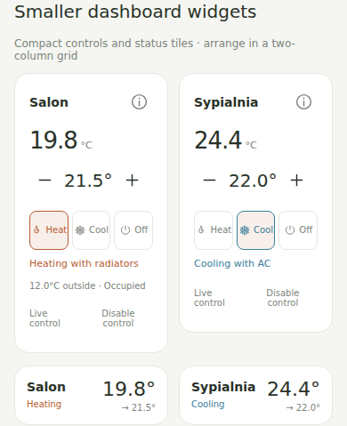

# Room Comfort

[](https://github.com/qmciaq/ha-room-comfort/actions/workflows/validate.yml)
[](https://my.home-assistant.io/redirect/hacs_repository/?owner=qmciaq&repository=ha-room-comfort&category=integration)

[](https://github.com/qmciaq/ha-room-comfort/releases/latest)
[](LICENSE)

**One temperature control for a whole room: radiators, reversible AC, and an independent room sensor.**

Use radiators for ordinary heating, request a timed AC heat boost, or switch the
room to cooling. Keep comfortable Away targets for a pet, prepare rooms before
returning, and pause control when outdoor conditions, an open window or an empty
room make it unnecessary.

[Install](#installation) · [Quick start](#quick-start) · [Dashboard cards](#dashboard-cards) · [Outdoor limits](#outdoor-temperature-limits) · [Windows & presence](#doors-windows-and-room-presence) · [Blueprints](docs/automations.md) · [Troubleshooting](#troubleshooting)

## Try the interactive demo

[**Open the demo →**](https://qmciaq.github.io/ha-room-comfort/)

Try Heat/Cool/Off, targets, AC boost, Vacation, Coming home, compact widgets,
English/Polish and light/dark themes. Scenario presets demonstrate outdoor gates,
an open window, elapsed room absence and everyone being away. **All devices and
readings are simulated**; nothing connects to a Home Assistant installation.
Scenarios jump to the resulting state rather than running the Python controller
or modelling room physics. Reset restores the original sample rooms.

The demo deploys through the [Deploy interactive demo workflow](https://github.com/qmciaq/ha-room-comfort/actions/workflows/demo.yml).
For the first deployment, the owner must select **Settings → Pages → Source →
GitHub Actions**, then rerun the workflow. No extra token or secret is needed.


## What you get

| Feature | Behaviour |
| --- | --- |
| Room thermostat | One target and explicit Heat / Cool / Off for all assigned devices |
| Smooth radiator heating | PID with deadband, anti-windup and bounded native TRV setpoint adjustments |
| AC heat boost | An explicit assist that ends at the target or the selected timeout |
| Cooling | AC cools only after all radiators confirm Off; minimum AC off time is enforced |
| Home / Away / Vacation | Separate heating and cooling targets for every room |
| Household presence | Away starts only when every chosen person/tracker is confirmed outside the selected HA zone |
| Coming home | A manual switch prepares enabled rooms in each room's selected Heat or Cool mode |
| Outdoor limits | Global defaults, per-room overrides, or no outdoor restriction for a particular room |
| Door/window contacts | Pause after continuous opening for a configurable number of seconds |
| Room presence | Independent heating and cooling absence timers, with automatic resumption |
| Bundled UI | Full controls, compact controls, status tiles and an all-room sidebar; English/Polish and light/dark themes |
| Automation support | Native climate/number/select/switch/button entities and four reusable blueprints |

This is a custom integration in active development. Local and isolated HA tests
cover the controller and UI; real TRV/AC response and PID tuning still need checking
on your own hardware. **Heat demand is calculated demand, not measured valve opening.**

## Requirements

- Home Assistant **2026.10.0 or newer**.
- A separate room temperature `sensor` in °C or °F.
- At least one physical radiator `climate` entity supporting Heat, Off and a single target temperature.
- Optional reversible AC `climate` supporting Heat, Cool, Off and a target temperature.
- Optional outdoor temperature sensor, door/window contacts, room presence sensors, and people/device trackers.

The integration and all cards are installed together. There is no Node build,
separate card dependency, runtime cloud service, or extra account required.

## Installation

### HACS custom repository

The repository is public and can be added as a **custom Integration repository**.
It is not currently listed in HACS's default catalog.

[](https://my.home-assistant.io/redirect/hacs_repository/?owner=qmciaq&repository=ha-room-comfort&category=integration)

1. Install [HACS](https://www.hacs.xyz/docs/use/) if needed.
2. In HACS, open **⋮ → Custom repositories**.
3. Add `https://github.com/qmciaq/ha-room-comfort` with type **Integration**.
4. Download **Room Comfort**, then restart Home Assistant.
5. Open **Settings → Devices & services → Add integration → Room Comfort**.

Select the latest named release in HACS. Integration code, sidebar and card
updates are delivered together. Restart HA and refresh the browser after updating.
If you installed a default-branch/commit build before the first release and no
update appears, use **HACS → Room Comfort → Redownload** once and select the
latest release.

### Manual installation

1. Download the install ZIP from the [latest release](https://github.com/qmciaq/ha-room-comfort/releases/latest), or [download the repository ZIP](https://github.com/qmciaq/ha-room-comfort/archive/refs/heads/main.zip).
2. Copy `custom_components/room_comfort/` into your HA configuration directory's `custom_components/` folder.
3. Restart Home Assistant, then add **Room Comfort** through Devices & services.
4. For automation templates, import the blueprints separately; see [the guide](docs/automations.md).

Do not put the entire repository inside `custom_components`. The final integration
path should be `/config/custom_components/room_comfort/manifest.json`.

## Quick start

1. Create a room, select its independent temperature sensor and radiator entities, and optionally assign AC.
2. Open **Room Comfort** in the sidebar. New rooms start in **Observe only**, which sends no commands.
3. Set the room's Home/Away/Vacation temperatures and choose Heat or Cool.
4. Review the planned demand and device states, then enable **Control devices** when ready.
5. Open the automatically created **Home modes** configuration entry to set household trackers, outdoor defaults and the Coming home timeout.

Add the integration again for each additional room. Physical actuators cannot
belong to two Room Comfort rooms. Disable conflicting device schedules or other
controllers before giving a room live control.

## Dashboard cards

Use **Edit dashboard → Add card**, then search for **Room Comfort**. Every card has
a graphical editor; you can also paste the examples below. Cards use the same
room thermostat entities and services as the sidebar.

| Card | Use it for |
| --- | --- |
| `custom:room-comfort-card` | Full room controls, profile temperatures, device details and conditions |
| `custom:room-comfort-mini-card` | Compact controls with current/target temperatures, ± buttons, modes and live-control switch |
| `custom:room-comfort-status-card` | A small status row with current → target temperature; tap for HA details |
| `custom:room-comfort-overview` | All configured rooms, search, filters and shared household controls |



Two compact widgets next to each other:

```yaml
type: grid
columns: 2
square: false
cards:
  - type: custom:room-comfort-mini-card
    entity: climate.salon
  - type: custom:room-comfort-mini-card
    entity: climate.bedroom
```

Use `custom:room-comfort-status-card` for shorter status rows, or place full and
compact cards in a Sections dashboard. In the visual card editor, **Card layout**
also lets you switch between full, compact and status views.

```yaml
type: custom:room-comfort-card
entity: climate.salon
show_devices: true
show_sensor: true
```

Replace the example IDs with your **Room Comfort thermostats**, not individual
TRVs or AC units. The frontend is registered automatically. If your dashboard
needs an explicit resource, add this URL as a **JavaScript module**:

```text
/room_comfort_frontend/room-comfort.js?v=0.5.0
```

[Mobile overview](docs/images/mobile.png) · [Dark theme](docs/images/dark.png)

## Outdoor temperature limits

Configure global defaults under **Room Comfort → Home modes → Configure**.
Select a numeric outdoor temperature sensor and enable outdoor limits. Each room's
configuration offers `inherit`, `custom`, or `disabled`:

- **inherit:** use the global sensor, thresholds, hysteresis and freshness limit.
- **custom:** use this room's thresholds; optionally select another outdoor sensor, otherwise use the global sensor.
- **disabled:** this room ignores outdoor temperature restrictions.

Example: **Heat below 16°C, Cool above 24°C, hysteresis 0.5°C**.
Heating becomes eligible below 16°C and remains eligible until outdoor temperature
reaches 16.5°C. Cooling becomes eligible above 24°C and remains eligible until it
falls to 23.5°C. The room thermostat still decides demand from the room sensor and
the active target. Setting hysteresis to zero gives strict thresholds.

At 18°C outside, a room requesting 21°C stays in Heat mode with its target intact,
but heating is paused. Limits apply to radiator PID, AC boost and Coming home.
They do not select Heat/Cool automatically. Missing, invalid or stale outdoor data
pauses temperature control while an outdoor policy is enabled. Outdoor limits
start disabled until you configure a sensor and enable them.

## Doors, windows and room presence

Select **Door/window contacts** in the room configuration. Contacts must report
`on` when open and `off` when closed. If a contact stays open for the configured
**open delay** (default 10 seconds), the room requests radiator heating and AC Off.
A shorter opening does not pause control. Closing resumes ordinary control,
subject to AC cooldown. Unknown/unavailable contacts pause immediately because a
closed window cannot be confirmed. Set zero seconds for immediate pause.

Select one or more binary **Room presence/motion sensors**. Any `on` means occupied;
every selected sensor must be `off` before absence timers run. Configure separately:

- Pause heating when empty, after **30 minutes** by default.
- Pause AC cooling when empty, after **10 minutes** by default.

Either pause can be disabled. Presence resuming allows normal control immediately;
AC still respects its minimum off time. Unknown presence keeps comfort and resets
the absence timer. No selected presence sensors means no room-occupancy restriction.
Timers restart on HA restart or room settings reload.

**Coming home deliberately bypasses empty-room pauses** so it can prepare an empty
house. It still obeys windows, outdoor limits and device interlocks. For a pet,
choose presence sensors that detect the pet reliably, or leave empty-room heating
pause off; household Away temperature and room occupancy are separate controls.

## Home, Away, Vacation and Coming home

Each room has separate temperature banks:

| Profile | Default Heat target | Default Cool target |
| --- | ---: | ---: |
| Home | 21°C | 24°C |
| Away | 19°C | 27°C |
| Vacation | 17°C | 29°C |

These are editable presets. The thermostat's main target edits the active profile
in the current Heat/Cool bank. All profile number entities use °C.

- **Automatic away:** every selected `person`/`device_tracker` must be confirmed outside the chosen HA geographical zone for the confirmation delay (default 5 minutes). Unknown trackers keep Home comfort. HA zones are not indoor room areas.
- **Vacation:** an explicit manual switch; it does not start from absence or clear from an arrival.
- **Coming home:** a manual switch that clears Vacation and uses each enabled room's **For my return** Heat/Cool selection and Home target. Disabled rooms remain observe-only; AC heat boost remains a separate request.
- **Ready:** enabled rooms have reached the relevant side of their Home target, within 0.2°C, with no blocking sensor/window fault. Coming home holds until a new confirmed arrival, cancellation, or timeout (default 4 hours).

Priority is **Coming home → Vacation → confirmed Away → Home**. Manual household
states and an active return deadline survive restart. Ordinary profile changes do
not switch an Off room on.

## Automation blueprints

Four templates provide forms for scheduled Home temperatures, a manual return
button, ready notifications, and Heat/Cool/Off triggers. Public GitHub URLs now
support HA's blueprint importer. HACS integration downloads do not install
blueprints automatically.

[Import and configure blueprints →](docs/automations.md)

For custom automations, use room climate entities, profile number entities,
per-room return-mode selects and shared household switches. Commands sent directly
to managed physical devices may be overwritten by the room controller.

## Troubleshooting

| Symptom | Check |
| --- | --- |
| No devices respond | Fresh installations start observe-only; enable Control devices and select Heat or Cool. |
| Cool is unavailable | Assign an AC supporting Heat/Cool/Off, and check it is available. |
| Heat/Cool is paused | Read the card's status: outdoor gate, open contact, empty room, stale sensor or device error. Targets are retained. |
| Radiators do not heat with an offline AC | An assigned AC must confirm cooling is stopped; repair it or unassign it to use radiators independently. |
| AC does not restart immediately | The minimum off interval is at least 180 seconds. |
| Room overshoots or undershoots | Check sensor placement/calibration, native TRV schedules and PID gains. The TRV adapter trims setpoints; it does not control valve percentage. |
| A card is missing or old | Restart after integration updates, refresh the browser and verify the resource URL above. |
| HACS cannot find Room Comfort | Add this URL as a custom repository of type Integration; it is not in the default catalog. |

No central boiler or shared multi-split coordination is provided. Sensor history
opens through Home Assistant's more-info dialog. See [controller details](docs/control-behavior.md)
for command ordering, safety checks and shutdown behaviour.

## Help and contributing

[Report a bug](https://github.com/qmciaq/ha-room-comfort/issues/new?template=bug_report.yml) · [Request a feature](https://github.com/qmciaq/ha-room-comfort/issues/new?template=feature_request.yml) · [Changelog](CHANGELOG.md) · [Contributing](CONTRIBUTING.md)

Coding agents: start with [AGENTS.md](AGENTS.md), which references the shared
[contribution rules](agents/contributing.md).

When reporting device behaviour, include HA/integration versions, entity capabilities
and relevant logs; remove tokens, coordinates and personal tracker details.

## License

[MIT](LICENSE) — use, modify and redistribute the project, including commercially,
while retaining the copyright and license notice. The installed integration also
includes the license.

## Development and validation

```sh
python3 scripts/validate.py
python3 -m unittest discover -s tests -v
npm ci --ignore-scripts
npx playwright install chromium
npm run check
npm test
python3 scripts/package.py
```

Run `python3 -m http.server 8080` and open `http://localhost:8080/dev/` for the
interactive simulated-device UI. The optional real-Core smoke check uses an isolated
HA 2026.10.4 instance with simulated devices; install `homeassistant==2026.10.4` and
`home-assistant-frontend==20260930.5` under Python 3.14, then run
`python scripts/smoke_ha.py`. It never connects to your live HA.

`python3 scripts/build_demo.py --standalone` builds the portable Pages site in
`dist/demo/` and refreshes `preview.html`. The site uses relative asset paths and
is tested under the `/ha-room-comfort/` project prefix before deployment. Only the
demo HTML and the production card bundle are uploaded to Pages.

Related projects: see
[Mushroom](https://github.com/piitaya/lovelace-mushroom),
[Better Thermostat](https://github.com/KartoffelToby/better_thermostat) and
[Versatile Thermostat](https://github.com/jmcollin78/versatile_thermostat) for other
approaches to dashboard cards and room control.

Versioned releases are published automatically after Python/browser tests, isolated
HA Core smoke tests, hassfest and HACS validation pass on `main`. Update the
manifest/version metadata and add the matching changelog section for a new
version. Already published versions are never replaced. To retry publishing, rerun
**Validate Room Comfort** from Actions; no personal token is required.
